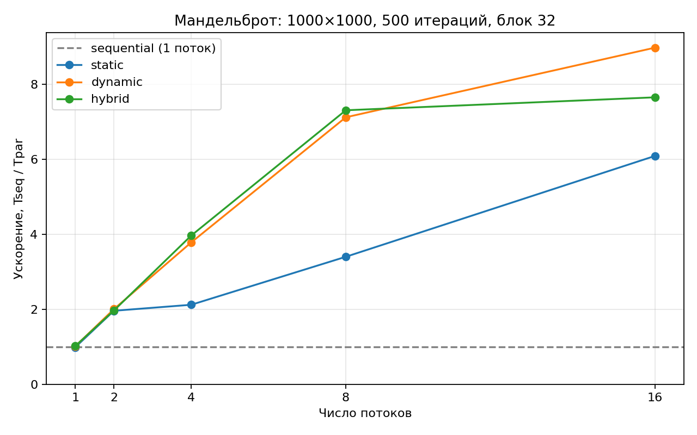

# Мандельброт: параллельные стратегии (Java 21)

Генерация множества Мандельброта четырьмя стратегиями — `sequential`, `static`, `dynamic`, `hybrid` — с попиксельно одинаковым результатом. CLI сохраняет PNG, бенчмарк измеряет время, ускорение и эффективность.

Точка `c` чёрная, если `z₀ = 0`, `zₙ₊₁ = zₙ² + c` не выходит за радиус 2 за `--max-iterations` шагов; иначе цвет зависит от итерации выхода.

## Требования

- **JDK 21** — сборка и запуск. Gradle ставить не нужно: Wrapper уже в репозитории.
- **Python 3 + matplotlib** — только для построения графиков.

## Быстрый старт

```bash
./gradlew build
./gradlew run --args="--mode dynamic --threads 8 --block-height 32 --output fractal.png"
```

В Windows — `gradlew.bat` вместо `./gradlew`.

## Команды

| Команда | Действие |
|---|---|
| `./gradlew build` | сборка и тесты |
| `./gradlew test` | тесты JUnit 5 |
| `./gradlew run --args="..."` | генерация PNG |
| `./gradlew benchmark` | замеры → `results/benchmarks.csv` |
| `./gradlew clean` | очистка `build/` |

Makefile: `make build`, `make test`, `make run ARGS="..."`, `make benchmark ARGS="..."`, `make clean`, `make rebuild`; все цели — `make help`.

## Параметры CLI

| Параметр | По умолчанию | Описание |
|---|---|---|
| `--mode` | `sequential` | `sequential`, `static`, `dynamic` или `hybrid` |
| `--width` / `--height` | `800` / `600` | размер изображения, пикс. |
| `--xmin` / `--xmax` | `-2.5` / `1.0` | границы по действительной оси |
| `--ymin` / `--ymax` | `-1.25` / `1.25` | границы по мнимой оси |
| `--max-iterations` | `500` | предел итераций |
| `--threads` | число логических CPU | в `sequential` игнорируется |
| `--block-height` | `64` | строк в блоке; для `dynamic` и `hybrid` |
| `--output` | `fractal.png` | путь к PNG |

```bash
./gradlew run --args="--mode hybrid --width 1920 --height 1080 --max-iterations 1000 --threads 16 --block-height 32 --output hybrid.png"
```

## Алгоритмы

| Режим | Класс | Распределение работы |
|---|---|---|
| `sequential` | `SequentialRenderer` | один поток, полный обход пикселей |
| `static` | `StaticRenderer` | равные непрерывные диапазоны строк |
| `dynamic` | `DynamicRenderer` | блоки строк из общего атомарного счётчика |
| `hybrid` | `HybridRenderer` | локальные очереди + work stealing |

Все режимы используют общий `Mandelbrot.pixelColor`, поэтому массивы пикселей совпадают.

## Замеры

```bash
./gradlew benchmark
```

2 прогрева + 5 замеров, медиана; замеряется только рендеринг. По умолчанию: размеры `1000,2000,4000`, итерации `200,500,1000`, потоки `1,2,4,8,16`, блоки `8,32,128`. Полный перебор потоков и блоков — только для reference-сцены `1000×1000`, 500 итераций; остальные сцены — 16 потоков, блок 32.

Переопределение параметров (списки через запятую):

```bash
./gradlew benchmark --args="--sizes=2000 --iterations=500 --threads=1,2,4,8 --block-heights=8,32 --output=results/run-2000"
```

Колонки CSV: `algorithm, width, height, max_iterations, threads, block_height, time_ms, speedup, efficiency`; `speedup = Tseq / Tpar`, `efficiency = speedup / threads`.

## Графики

```bash
python3 scripts/plot_benchmarks.py   # Windows: python scripts/plot_benchmarks.py
```

Скрипт читает `results/benchmarks.csv` и строит по reference-сцене `1000×1000`, 500 итераций, блок 32: `results/time.png`, `results/speedup.png`, `results/efficiency.png`.



## Структура

```
src/main/java/mandelbrot/
├── core/        RenderParameters, Renderer, Mandelbrot
├── render/      SequentialRenderer, StaticRenderer, DynamicRenderer, HybridRenderer
├── cli/         Main, PngWriter
└── benchmark/   BenchmarkRunner, BenchmarkConfiguration, BenchmarkResult, CsvWriter
src/test/java/mandelbrot/   тесты ядра, режимов, CLI и бенчмарка
results/         benchmarks.csv, time.png, speedup.png, efficiency.png
scripts/         plot_benchmarks.py
```

## Тесты

`./gradlew test` — JUnit 5. `RendererEquivalenceTest` сверяет все четыре режима с независимым эталоном: некруглые размеры, неполный последний блок, 1 и 16 потоков, маленькое изображение, разные лимиты итераций, повторные запуски `dynamic` и `hybrid`. Остальные тесты — ядро, CLI, бенчмарк и CSV.